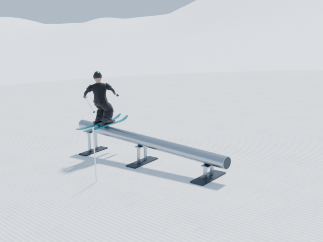
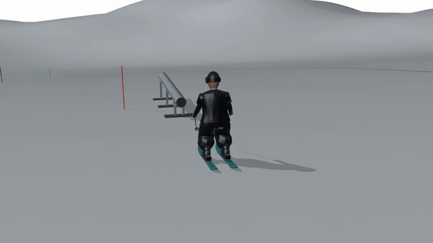

# Snowpark Simulator

Generate 3D snowpark scenes in Blender and synthetic images under known, repeatable conditions. The project supports experiments in multi-camera acquisition and **Gaussian Splatting**, a 3D representation built from Gaussian primitives.

The scene includes snow-covered terrain, a rail, a rigged athlete, and skiing motion. It is a procedural environment for visual experiments: bone rotations define the movement, without a calibrated physics simulation.



## Quick start

Requires **Python ≥ 3.11** and **Blender**. No additional Python packages are needed to generate the static environment.

```sh
git clone https://github.com/Blackhand01/snowpark-simulator.git
cd snowpark-simulator
python3 -B -m snowpark_simulator scene --without-reference
```

This command builds the initial static environment, saves `snowpark.blend`, renders four views, and reopens the file in a separate Blender process for verification. The athlete and motion shown in the demonstration images require subsequent workflows.

Blender is resolved through `--blender`, the `SNOWPARK_BLENDER` environment variable, `PATH`, then the macOS application:

```sh
python3 -B -m snowpark_simulator scene --without-reference --blender /path/to/blender
python3 -B -m snowpark_simulator --help
python3 -B -m snowpark_simulator motion --help
```

For a quick installation check:

```sh
python3 -B -m snowpark_simulator scene --without-reference --config configs/scene/smoke.toml
```

Each build creates a new `outputs/<stage>-<UTC>/` directory containing the scene, renders, frozen configuration, source snapshots, logs, and verification results. Previous outputs are not overwritten. Interactive navigation in Blender is a separate check from automated verification.

## Motion preview



Workbench preview with simplified materials, exported at 20 frames per second; the movement lasts approximately five seconds. It shows articulation and timing rather than final render quality. The animated scene and datasets are not included in the clone.

## Commands and configuration

| Command | Responsibility |
| --- | --- |
| `scene` | Static environment and independent verification |
| `terrain` | Slope morphology and terrain contact |
| `athlete` | Snow comparison and a static rigged athlete |
| `appearance`, `presentation` | Clothing, equipment, and readable snow detail |
| `motion` | Movement construction, verification, and preview |
| `capture` | Calibrated camera views, frozen poses, and dataset verification |
| `conditions` | Controlled lighting, snow, haze, and occlusion variants |
| `brush` | Optional Gaussian Splatting backend |

Configurations are grouped under `configs/scene/`, `motion/`, `capture/`, `conditions/`, and `tricks/`. **Advanced profiles contain paths and hashes from historical runs**: supply the required inputs and update the profiles before using them. A fresh clone directly reproduces only the static demo, not the complete pipeline shown in the images.

## Project layout and development

```text
snowpark_simulator/   CLI, workflows, and execution management
scripts/             Generators, libraries, and verifiers run inside Blender
tools/               Analysis, evaluation, and evidence composition
configs/             Scene and experiment parameters
tests/               Automated tests without Blender
notebooks/           Optional Colab Free research pilot
assets/              Textures and provenance manifests
docs/                Architecture, development guide, and two previews
outputs/             Local results, excluded from Git
```

[Architecture and responsibilities](docs/architecture.md) · [Development, workflows, and tests](docs/development.md) · [Assets and licenses](ASSET_CREDITS.md)

For the bounded dynamic reconstruction experiment, see the
[4DGS pilot protocol](docs/4dgs.md) and [Colab Free notebook](notebooks/4dgs_colab.ipynb).
It requires the approved local animated scene and a separately verified synthetic
dataset. GPU availability, successful fitting and visual quality are separate checks;
the included research backend is not cleared for commercial use.
The first Free T4 pilot completed both fits but failed reconstruction-quality
targets; see the [measured results and limitations](docs/4dgs.md#observed-free-t4-pilot-18-october-2026).

```sh
python3 -B -m unittest discover -s tests -v
ruff check .
ruff format --check .
```

## Limitations and optional dependencies

Development was verified with Blender 5.2.2 LTS on macOS Apple Silicon; other platforms require separate verification. Geometry, clothing, snow, and movement are artistic approximations, without calibrated forces, friction, or biomechanics. The character remains visibly synthetic.

Tools under `tools/` may require NumPy, Pillow, Matplotlib, and scikit-image; video encoding and timing comparisons require FFmpeg/FFprobe. Brush v0.3.0 is optional, installed separately, and never downloaded automatically. No Blender add-on is required.

Geometry and the character are procedural. **Snow 01** textures by Rob Tuytel / Poly Haven are CC0: see [sources and manifest](ASSET_CREDITS.md). No personal photograph is distributed as a texture.
