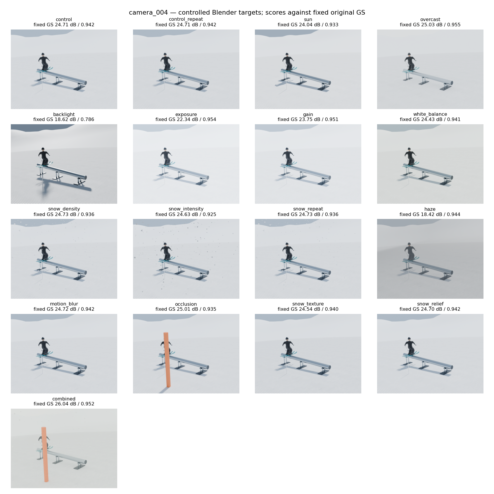

# Snowpark Simulator

Ambiente Blender procedurale con pista innevata, rail, atleta articolato e animazione di un boardslide sugli sci. Include strumenti per render da più camere, esportazione di pose e variazioni controllate della scena.


## Movimento

Ingresso sul rail, cambio di orientamento di 180°, uscita, ricezione e scivolamento finale. Il movimento è animato tramite **cinematica diretta**: le rotazioni delle ossa determinano la posa del personaggio.


L'anteprima usa materiali semplificati della viewport Workbench. La sequenza completa dura circa 5 secondi; la scena animata usa 120 campioni al secondo. La GIF è esportata a 20 fotogrammi al secondo.

[Sequenza di nove pose](docs/images/boardslide-sequence.jpg).

## Funzionalità

- Terreno tridimensionale, montagne, rail tubolare e appoggi configurabili.
- Atleta procedurale con armatura a 22 ossa, abbigliamento, sci e accessori.
- Animazione articolata, camera di revisione e controlli di continuità e contatto.
- Acquisizione RGB da camere calibrate, posa congelata e separazione delle viste di addestramento e verifica.
- Varianti di luce, esposizione, bilanciamento del bianco, neve visibile, foschia, sfocatura da movimento e occlusione.
- Strumenti opzionali per **Gaussian Splatting**, una rappresentazione della scena mediante primitive gaussiane tridimensionali, con backend Brush.

## Avvio rapido: ambiente statico

Richiede **Python 3.11 o successivo** e **Blender**. La versione usata durante lo sviluppo è Blender 5.2.2 LTS su macOS Apple Silicon; altre piattaforme non sono state verificate.

```sh
git clone https://github.com/Blackhand01/snowpark-simulator.git
cd snowpark-simulator
python3 -B run.py --without-reference
```

Questo comando genera l'ambiente statico iniziale, quattro render e una verifica del file riaperto in un secondo processo Blender. Non genera l'animazione mostrata sopra. Non richiede fotografie, modelli esterni o pacchetti Python aggiuntivi.

Ogni esecuzione crea `outputs/p1-<UTC>/`, contenente:

| File | Contenuto |
| --- | --- |
| `snowpark.blend` | Ambiente statico navigabile |
| `main.png`, `side.png`, `opposite.png`, `high.png` | Quattro viste della scena |
| `build-report.json`, `verification.json` | Parametri e controlli geometrici |
| `execution.json`, `*.log`, `source/` | Comandi, esiti e sorgenti usati |

Il percorso predefinito di Blender è quello macOS. Per un'installazione diversa:

```sh
python3 -B run.py --without-reference --blender /percorso/a/blender
```

Per cambiare dimensioni, materiali, luce o qualità di render, copiare `config.toml` dentro il repository e passare `--config nome-config.toml`. Il tempo di rendering dipende dalla macchina e dal numero di campioni.

## Pipeline avanzata

| Strumento | Funzione |
| --- | --- |
| `run_p2.py`, `run_refinement.py` | Confronto neve, atleta e geometria della pista |
| `run_athlete_look.py`, `run_presentation_finish.py` | Abbigliamento e materiali |
| `run_motion.py` | Costruzione, verifica e anteprima del movimento |
| `run_capture.py` | Render da più camere e congelamento della posa |
| `run_conditions.py` | Varianti controllate di rendering |
| `run_brush.py` | Esecuzione del backend Brush locale |
| `scripts/` | Generatori, verificatori, esportazione e analisi |
| `configs/tricks/` | Profili sperimentali alternativi |

**I profili avanzati conservano percorsi e hash di input specifici di precedenti esecuzioni.** Scene `.blend`, dataset, modelli addestrati e video di riferimento non sono distribuiti nel repository. Per usare questi profili occorre fornire gli input previsti e aggiornare le relative configurazioni e impronte SHA-256. Il solo clone non riproduce l'animazione illustrata.

I wrapper avanzati usano il percorso Blender macOS scritto nei rispettivi script. Alcuni strumenti di analisi richiedono NumPy, Pillow, Matplotlib o scikit-image; la codifica video richiede FFmpeg e FFprobe. Il backend Brush v0.3.0 è opzionale e va installato separatamente nel percorso indicato in `run_brush.py`. Non è incluso né scaricato automaticamente.

## Varianti della scena



Le immagini sono render sintetici della stessa posa. Le sigle e i punteggi presenti nel pannello confrontano ciascun render con una ricostruzione Gaussian Splatting fissa: **PSNR** misura l'errore tra pixel in decibel, **SSIM** la similarità strutturale. Non sono una misura di qualità fisica della simulazione né una verifica su camere reali.

## Limiti

Il movimento è cinematica animata; forze, attrito, tessuti e biomeccanica non sono calibrati. Neve e foschia sono effetti grafici. Le dimensioni sono parametri artistici, non un rilievo metrico. La ricostruzione Gaussian Splatting è sperimentale e può mostrare trasparenze o perdita di dettagli sull'atleta.

Il verificatore statico controlla geometria chiusa del rail, volumi, rilievo del terreno, coordinate finite, accessibilità mediante raggi e assenza di animazione. Questi controlli non sostituiscono una validazione fisica.

## Asset

Geometria e personaggio sono procedurali. Le mappe neve **Snow 01** di Rob Tuytel / Poly Haven sono CC0. Provenienza e impronte dei file sono documentate in [ASSET_CREDITS.md](ASSET_CREDITS.md) e nel [manifest delle texture](assets/polyhaven/snow_01/1k/manifest.json).
