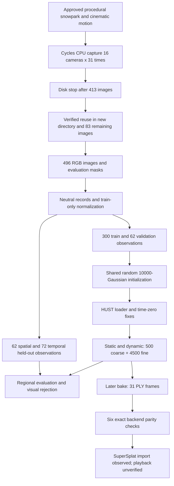

# Baseline audit and evidence ledger

> Sequential-revision context (18 October 2026): the current repository is now `/Users/stefanoroybisignano/Desktop/GaussianSplatting/synthetic-scene-simulator`; old `Idea-Validation/` paths below are historical provenance. This revision does not rerun or rewrite measurements. Current root README records full-action 0–5.02-s intent, while B0 remains the 0.9–1.9-s pilot. Freeze the original artifact/config identities, not today's working tree. New experiments must follow the [dual-reference sequential protocol](06-sequential-optimization.md).

## Scope, sources and current-state boundary

The current repository path and Git HEAD were checked before design. No applicable filesystem `AGENTS.md` was found in the searched ancestor/repository locations; the instructions supplied in the conversation apply. Read entry documents: [README](../../README.md), [architecture](../architecture.md), [development](../development.md), [4DGS protocol](../4dgs.md), [package configuration](../../pyproject.toml), archived `.local/refactor-archive/docs/OMNISTANCE_CONTEXT.md` and the staged prompt context. Archived workflow names and gates are historical, not current execution authorization.

Evidence anchors below are relative to the repository, and are immutable historical runs unless explicitly described otherwise:

| ID | Source | What it establishes |
| --- | --- | --- |
| E1 | [Capture plan](../../configs/capture/4dgs-pilot.json), [partition contract](../../snowpark_simulator/pilot4d.py) | Scene identity, cameras, frames, dimensions, split |
| E2 | [Capture REPORT](../../outputs/4dgs-colab-20261017T232523-251650Z/REPORT.md) | Capture, disk interruption, recovery, archive and preparation history |
| E3 | [Pilot REPORT](../../outputs/4dgs-pilot-20261018T101121-285573Z/REPORT.md) | Environment, corrections, completed training, evaluation and failed quality gates |
| E4 | [Pixel balance](../../outputs/4dgs-pilot-20261018T101121-285573Z/training-pixel-balance.json), [visual review](../../outputs/4dgs-pilot-20261018T101121-285573Z/visual-review.json) | Foreground pixel share and prior qualitative inspection |
| E5 | [Later export REPORT](../../outputs/4dgs-ply-20261018T113620-018590Z/REPORT.md), [status](../../outputs/4dgs-ply-20261018T113620-018590Z/status.json), [manifest](../../outputs/4dgs-ply-20261018T113620-018590Z/cloud-export/baked/manifest.json) | Export, parity, import and explicitly incomplete playback validation |
| E6 | [Preparation](../../tools/prepare_4dgs.py), [CUDA adapter](../../tools/colab_4dgs.py), [evaluation](../../tools/evaluate_4dgs.py), [exporter](../../tools/export_4dgs.py) | Executable protocol and metric semantics; read only here |
| E7 | [Calibration](../../scripts/capture_scene.py), [motion capture](../../scripts/capture_motion.py) | Camera axes, image-edge convention, capture and combined athlete mask |

E5 postdates E3: E3's statement that export had not occurred is superseded. During this audit `docs/4dgs.md` acquired a concurrent export section. The exporter and its test were already untracked at entry; this audit does not own them. Historical reports are evidence of prior execution, not freshly rerun tests.

## Repository and reusable components

Entry: `python3 -B -m snowpark_simulator`; `cli.py` lazily selects `workflows/`. Python requirement is ≥3.11 for host orchestration. `artifacts.py` provides contained paths, UTC output directories, hashes and source snapshots; `execution.py` provides separate offline Blender processes, argument arrays and retained logs. Reuse these boundaries.

| Stage | Existing modules/configurations | Reuse / qualification |
| --- | --- | --- |
| Environment | `scripts/build_scene.py`, `terrain_geometry.py`, `terrain_profile.py`, `refine_terrain.py`; `configs/scene/` | Snow and rail generation; leave validated scenes untouched |
| Athlete and clothing | `athlete_proxy.py`, `athlete_fit.py`, `athlete_clothing.py`, verification scripts | Procedural rig and clothes; not an SMPL body or measured biomechanics |
| Motion | `motion_profile.py`, `trick_profile.py`, `rail_slide_profile.py`, `reference_clock.py`; `configs/motion/boardslide-synced.toml` | Cinematic kinematics and retiming; not a physical contact simulation |
| Capture | `capture_scene.py`, `capture_motion.py`, `workflows/capture.py`, `configs/capture/4dgs-pilot.json` | Calibrated fixed-camera time samples; reuse after separately approved new plan |
| Data | `pilot4d.py`, `tools/prepare_4dgs.py` | Explicit train/evaluation separation, normalization, random seed cloud |
| Training | `tools/colab_4dgs.py`, existing notebook | Pinned HUST backend plus documented loader/initialization adaptations |
| Evaluation/export | `evaluate_4dgs.py`, `export_4dgs.py`, associated tests | Extend region/time evaluation; preserve exact historical evaluator |
| Optional static path | Brush workflow, historically Brush v0.3 | Not the backend of this dynamic pilot |

Host analysis uses NumPy, Pillow, Matplotlib, scikit-image and ffmpeg where needed. Blender 5.2.2 LTS is historically recorded. The dynamic CUDA environment is distinct from the host package and from current Colab defaults. Native CUDA extensions are not an M1 training solution.

## Actual executed data path

Scene file: `outputs/boardslide-synced-20261017T182924-532391Z/snowpark-motion.blend`, logical size 6,877,065 bytes. Historical SHA-256: `a8d42cad61740dc8e963b3f0d3bcb241149effe9db80a1014b742bf5dd32cccb`. It exists as a FileProvider placeholder; a fresh full byte hash and Blender reopening were **not completed** in this audit. The reports and source, not a new scene inspection, establish its structure.

## Cameras, instants and leakage boundary

- 640×480 RGB8 PNG, 24 Cycles samples, CPU with four threads, seed 1729; no motion blur or depth of field. Render noise is a possible limitation, not a measured cause.
- 31 instants at 30 Hz, inclusive endpoints 0.9–1.9 s. Source frame `109 + 4*i` at 120 fps; physical time `(frame-1)/120`; normalized time `i/30`.
- 16 stationary cameras in two rings. Plan coordinates imply approximately 12 m radius, 15°/35° elevation, 45° azimuth spacing and 22.5° inter-ring offset. These are calculations from declared positions, not a visibility-coverage score.
- Lens 45 mm, sensor width 36 mm; K approximately `[[800,0,320],[0,800,240],[0,0,1]]`, with authoritative per-record matrices. Camera calibration uses image-edge coordinates; raster pixel indices differ by 0.5.
- Capture reprojection maximum historically 0.000092977 px; actual CUDA-loader probe 0.0000199261 px. Both concern tested points/matrices, not reconstruction accuracy.

| Partition | Camera indices | Time indices | Count |
| --- | --- | --- | ---: |
| Fitting | 0,1,2,4,5,6,8,9,11,12,13,15 | All except 3,7,11,15,19,23 | 300 |
| Validation | 7,10 | All 31 | 62 |
| Historical spatial test | 3,14 | All 31 | 62 |
| Historical temporal test | Fitting cameras | 3,7,11,15,19,23 | 72 |

No temporal-test fitting images were admitted to the optimizer. However, **validation includes those six times from other cameras**. It is therefore inaccurate to call those times completely unseen by the development/selection process. The spatial test contains 12 joint new-camera/new-fitting-time observations; these were aggregated with the other 50. A future protocol must separate temporal validation and final times globally across cameras.

Final outputs were inspected in E3/E4, in the later export comparisons and during this audit (one existing dynamic triptych). These sets are now development sets. Renaming files or changing seeds does not restore final-test independence.

## Initialization, capacity and objective

E6 creates 10,000 seeded uniform points in model cube [-1,1]^3, with random byte colors 40–215. No original mesh, depth, skeleton or evaluation masks initialize the optimizer. Training-camera axes determine center `[0.00003161516067182776, -0.09633153176067201, 1.774575340080132]` m and scale `4.199999867965003` m/model-unit. `world = scale * model + center`. The cube spans approximately 8.4 m per side; its useful coverage has not been measured.

HUST revision: `843d5ac636c37e4b611242287754f3d4ed150144`. Both modes: 500 coarse + 4,500 fine iterations, seed 1729, batch 1, SH degree 3, white background, time-zero coarse initialization, densification until fine step 4,000, interval 100 inherited upstream, no extra point-addition, pruning interval 8,000. No scheduled interval-pruning event occurs within 4,500 fine steps; other densification internals must not be equated with this statement.

Deformation: multiresolution factors [1,2], width 64, configured depth 0, bounds 1.6. Dynamic mode enables displacement, scale and rotation deformation; opacity and SH deformation are disabled. Static mode disables those three too. Inherited grid configuration is spatial 64³ / temporal 25, 32 feature channels per plane. Bounds are model coordinates, not measured scene bounds.

**Objective correction:** the pinned [argument defaults](https://github.com/hustvl/4DGaussians/blob/843d5ac636c37e4b611242287754f3d4ed150144/arguments/__init__.py) set `lambda_dssim=0` and `lambda_lpips=0`; the local configuration does not override them. The [training loss](https://github.com/hustvl/4DGaussians/blob/843d5ac636c37e4b611242287754f3d4ed150144/train.py) is full-image L1 plus fine-stage grid regularization (time smoothness 0.01, temporal-plane L1 0.0001, spatial TV 0.0001). It is not an actively weighted L1+SSIM objective. These values are reconstructed from pinned source plus adapter; the dataless saved `cfg_args` did not hydrate within the bounded read. Confirm the complete resolved configuration before any rerun.

The visible combined athlete/equipment mask has mean training area 1.313356%, min 0.882161%, max 2.037760%; average bounding-box region covers 6.66158%. Thus a uniform image mean gives approximately 98.69% of pixel locations to the complement. Actual error magnitude, gradient norms, visibility, opacity and Gaussian allocation were **not measured by region**. Equipment and body were not independently scored. Masks were evaluation-only.

## Completed runs and cost

| Historical measurement | Static | Dynamic |
| --- | ---: | ---: |
| Training execution wall seconds | 154.550356 | 183.220038 |
| Final Gaussians | 16,636 | 17,507 |
| Peak PyTorch allocated bytes | 143,788,544 | 214,745,088 |
| Evaluation process seconds | 51.26 | 51.99 |

Allocated memory is **not** total device usage, peak reserved memory, CUDA context memory or host resident memory. Historical GPU: Tesla T4, 15,360 MiB total, 14,910 MiB initially free, driver 580.82.07. No current GPU session was acquired. Historical environment: Python 3.10.22, PyTorch 1.13.1+cu117, torchvision 0.14.1, CUDA compiler 11.8.89, NumPy 1.24.4, mmcv 1.6, Open3D 0.18.0. Historical native Colab Python 3.13.15 / torch 2.11+cu130 / NVCC 13.0.88 did not replace that isolated legacy environment.

Corrections actually made before the successful pilot: native 640×480 loading instead of forced square resizing; camera axes and dimensions; native Torch nearest-neighbor initialization replacing unavailable/unlicensed simple-knn; time-zero selection for the actual dataset wrapper; device placement in a diagnostic. The first static attempt failed before optimization steps. A discarded 100-step diagnostic took 3.5421 s in its loop / 29.85 s subprocess, peaked at 151,736,832 allocated bytes and observed a nonzero deformation gradient. This is not evidence that the final foreground fit was adequate.

Capture cost dominates the recorded training times: 82.06 min total render time, mean 9.93 s/image. Capture stopped after 413 observations when free disk fell below 8 GiB; recovery reused verified images and rendered 83 in a new directory. Recovery subprocess 1,189.71 s and inner capture 758.85 s use different timing scopes; hydration/verification also overlapped. Do not sum overlapping timers. Historical setup component times include torch download/install 91.29 s, remaining packages 84.82 s and rasterizer build 104.29 s; complete cold setup, queue and upload wall times are not known.

Storage/transfer evidence: input ZIP 174,385,886 bytes; result ZIP 445,752,901 bytes (621,221,496 bytes unpacked); dataset run directory 696,295,935 logical bytes including redundant copies/archive; pilot directory 1,069,768,925 logical bytes. Logical bytes are not resident disk allocation under FileProvider. Upload/download throughput and network retries were not measured.

## Quality, export and verification

| Historical score | Static | Dynamic | Meaning |
| --- | ---: | ---: | --- |
| Spatial athlete-bbox PSNR, dB | 12.8792 | 12.9631 | +0.08385 dB; inadequate novel views |
| Temporal athlete-bbox PSNR, dB | 13.7830 | 18.8384 | +5.0554 dB; still below gate |
| Spatial / temporal dynamic bbox SSIM | — | 0.6306 / 0.7395 | Below 0.85 |
| Spatial / temporal frames with bbox PSNR ≥20 dB | — | 0% / 37.5% | Fail broad coverage |
| Background PSNR change, spatial / temporal | — | -2.0961 / -0.3174 dB | Dynamic fitting does not preserve background automatically |
| Temporal residual reduction | — | 1.5022% | Historical target 25% |

Only 2/11 historical quality checks passed. Temporal full-frame PSNR around 30.02 dB concealed severe foreground defects. E4 records ghosting, transparency and missing equipment; one current reread of an existing triptych is consistent with this, not a new independent sample. Four 31-frame triptych videos decoded, but continuous visual playback was not fully checked.

Seen-training-view evidence consists of sampled whole-image progress PSNR, not a complete regional evaluation. Upstream reporting schedules sampled train/validation evaluations; console output under `--quiet` does not provide a retained regional result. Therefore a train-versus-new-view **foreground generalization gap cannot yet be quantified**.

Evaluation semantics: predictions were rounded to uint8 before comparison; PSNR used MSE in [0,1] with a 1e-12 floor; SSIM used scikit-image Gaussian weights, sigma 1.5, data range 1, channel axis 2 and population covariance. Athlete PSNR/SSIM are over projected bounding boxes plus margin, not exact body-only pixels. Visible-mask MAE and complement background metrics exist. Temporal score differences successive **error images** over union bounding boxes; it is not optical-flow tracking or physical-motion error.

Later export E5: 31 distinct PLY frames × 17,507 Gaussians; each 4,343,266 bytes, total 134,641,246 bytes. Export loop 8.336 s; subprocess 32.12 s; peak allocated 78,679,552 bytes. Six camera/time comparisons after serialized reload had maximum absolute image error 0.0 using the same CUDA renderer. Archive download was 89,982,414 bytes with historical CRC and 31 frame hashes verified. Degree-3 SH, log scale, opacity logits and WXYZ rotations were preserved; no optimization or pruning.

SuperSplat 3.5.2 imported the sequence and timeline. Actual skier playback, navigation, viewer parity, sustained fps and browser/process RAM remain unverified. Chronosplat's public demo was historically navigated, with cold-load stalls; that is not a benchmark of this model. Historical local tests progressed from 36/39 to 42 passing tests in E5, including export tests; this audit did not rerun them.

## Causal hypotheses and minimal discriminating controls

| Hypothesis, not conclusion | Evidence motivating it | Missing discriminant; future check only |
| --- | --- | --- |
| Too little useful foreground optimization | 1.31% mask share, uniform loss, brief fit | Regional seen-view PSNR, gradients and visibility; longer ordinary backend control |
| Bad initialization/coverage | Random cube, low-texture snow, missing athlete | Plot training-derived point support and reprojection; same-time triangulated initialization ablation |
| Insufficient model capacity or deformation | Reduced plane scales and depth; thin equipment | Capacity-only control after seen-view diagnostics; Gaussian count alone does not measure usable capacity |
| Camera or loader defect remains | Earlier bugs, but excellent probe reprojection | More varied existing points, transform round-trip and exported camera parity; no assumption of zero remaining bugs |
| Generalization/occlusion ambiguity | Large camera gaps, tiny target, rail | Seen vs held-view/time matrix and occlusion cases; improve future capture only after explicit approval |
| Hardware limitation | Declared 8 GB host, variable free GPU | Full peak telemetry and actual budget-hit evidence; currently no training memory/time ceiling was hit |
| Appearance mismatch/noise | 24-sample renders, snow highlights, shadows | Existing-image noise/appearance inspection; fixed photometric conventions and separate shadow residual experiment |

No optimization can demonstrate recovery of genuinely absent image detail. A reconstructed plausible ski edge and a measured correct ski edge are different claims.

## Concurrent player addendum — bounded snapshot, not this audit's execution

During preservation review, a separate workspace activity created `outputs/4dgs-player-20261018T125220-542663Z/`. Its records were read once near 13:11 UTC; [the extracted snapshot](concurrent-player-snapshot.json) freezes the evidence boundary. The earlier E5 statements above describe its earlier state and are superseded only as follows:

- `sog-verification.json` records 31 frames, 17,507 splats/frame, SH degree 3 and 22,181,056 SOG bytes versus 134,641,246 PLY bytes (6.0701× encoded-size ratio). This is a **lossy derivative's size**, not verified visual equivalence or decoded-memory savings.
- `conversion-gpu.json` records exit 0, 148.16 s and maximum child RSS 224,280,576 bytes; an earlier conversion attempt ended with code -15 after 127.51 s. These are separate attempt costs and do not establish complete cold setup cost. Upstream revision is `2278aa9321d46e3d99f4a8174d37e676be91e5e0`.
- UI observations at 13:02–13:04 UTC show real sequence frame advancement, with effective UI rates 8.6 and 5 fps and a stalled state. Those snapshots are not a sustained benchmark and do not meet Q5's proposed 30-fps gate.
- A memory-sampling log exists, including multiple Chrome processes and system-wide swap. A complete isolated player-memory comparison, finalized compression-fidelity report and final player REPORT were not available at this read boundary. Do not assign global swap to this model alone.

This audit neither installed nor ran the player, converter, benchmark or any agents; it only read these concurrently produced records. P08 must refresh that task's final evidence before duplicating work. The recommendation remains to reuse an existing player and measure actual end-to-end behavior.
