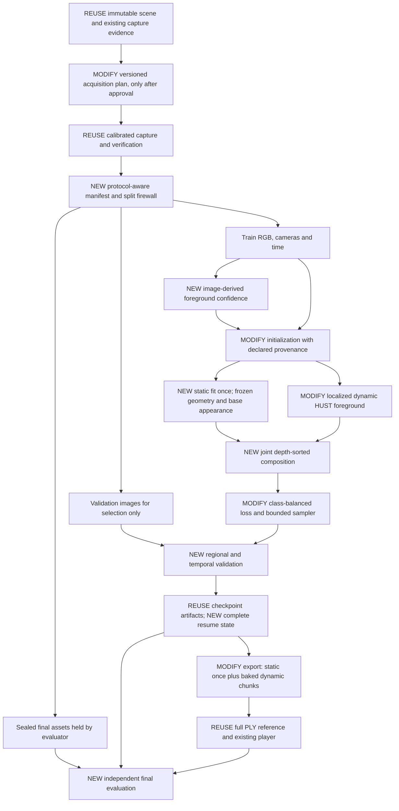
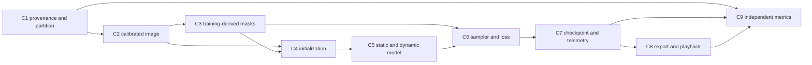

# Architecture and integration contracts

All interfaces below are **PROPOSED v1**, not implemented APIs. Existing pilot data keeps its original schema. A versioned adapter must translate it; never silently reinterpret historical files.

## Three architectures, one conditional recommendation

The [sequential protocol](06-sequential-optimization.md) governs all stages. Architecture A1 is a candidate, not the final mandated stack. HUST is the historical control; a different backend can be a separately approved treatment. Every experiment compares its candidate with immutable B0 and the last human-accepted parent. The data-flow diagram describes module dependencies, not permission to implement or optimize all modules together.

| Architecture | Representation | Quality opportunity / main risk | Total-cost and maintenance assessment |
| --- | --- | --- | --- |
| **A1 — recommended** | Static 3D Gaussians + localized HUST dynamic foreground; optional fixed-geometry appearance residual | Directly addresses background interference and small target. Does not enforce physical joints; random initialization and masks may still fail | Lowest migration risk; existing CUDA, evaluation and PLY paths reused. New separation/composition needs real integration tests. Benefit is unmeasured |
| A2 | Same static background + SC-GS-style sparse motion controls; equipment may use rigid transforms | Shared motion can stabilize skis and limbs; controls can blend incorrectly across joints or rail occlusions | Additional control pretraining, nearest-neighbor graph and custom rasterizer dependencies. Select only with a documented motion bottleneck and an approved matched comparison |
| A3 | Same static background + articulated GauHuman/GART foreground, HUGS-style scene separation; explicit equipment transforms and clothing residual | Strong body structure if poses/template fit; synthetic stylized rig, boots and clothing may violate prior | Highest preprocessing/license/maintenance burden. Body fitting must fit the budget before training advantage counts. Consider only after pose/shape feasibility evidence |

A1 is an engineering recommendation, not a novel scientific contribution. A2/A3 are mutually exclusive alternative development tracks until explicitly selected. None has demonstrated the proposed quality gates.

## Information protocols: strict separation

The image protocol is **calibrated-image reconstruction**, not uncalibrated reconstruction from RGB alone. Camera calibration and timestamps from acquisition are admitted, with their provenance. Original scene geometry is never secretly supplied to the image optimizer.

| Information | I0: images, no learned external prior | I1: images plus declared external prior | Assisted controls |
| --- | --- | --- | --- |
| Training RGB, known K/extrinsics, physical timestamps | Allowed | Allowed | Allowed |
| Training-derived masks, correspondence triangulation, temporal statistics | Allowed; record algorithm and manual image annotation time if used | Allowed | Allowed |
| Pretrained segmentation/depth/body/flow weights | Not allowed | Allowed only with identified weights, license, time and input provenance | Allowed if declared |
| Original Blender object masks | Evaluation only | Evaluation only | A-M: admitted for fitting, named separately |
| Blender depth / clean background / normals / mesh | Evaluation only | Evaluation only | A-D / A-B / A-G: explicit individual additions |
| Original rig, joints, per-part transforms, trajectories | Evaluation only | Evaluation only | A-R: admitted; rig-to-model conversion cost recorded |
| Validation RGB | Metrics and model-selection only | Same | Same |
| Final-test RGB, masks, depth, poses | Independent evaluator only, after model freeze | Same | Same |

An assisted experiment records the **exact set** of additional inputs, not a generic “assisted” label. A-M does not authorize A-R. Ground-truth evaluation masks cannot be copied into training-derived masks. Even camera placement optimized using original geometry is acquisition assistance and must be described; reconstruction claims remain conditional on that acquisition plan. A body model or diffusion prior is an external prior even if it was not trained on Blender.

Final-test geometry/cameras may be used by the capture custodian to generate or score a sealed test, but neither test RGB nor scene-derived fitting signals reach implementers. Publicly known test cameras are not the same as permission to fit their images. The current historical data is development-only.

## Proposed data flow

“MODIFY/NEW” describes future design scope, not changes made now. For diagnostics and first ablations, use the existing capture without executing B/C. Every optional change in the diagram is activated separately in the experiment plan.

## A1 design details

1. **Diagnose first.** Render existing checkpoints on all fitting/validation observations with regional metrics, no optimization. Inspect foreground support, opacity, gradients only if a separately approved backward diagnostic is needed. No claim of underfitting before this distinction.
2. **Foreground confidence from images.** Fixed-camera temporal variation/robust background estimates are a cheap I0 starting point. Use only training times; record invalid/ambiguous pixels and confidence. A temporal median is not a clean background where the athlete occupies a pixel most of the time. Shadows are appearance variation, not athlete geometry. If masks cannot retain thin equipment, stop or choose a declared I1/A-M control; do not substitute synthetic masks silently.
3. **Initialization.** Keep the random baseline. Test sparse calibrated matching/triangulation on the static scene and on synchronized foreground views separately. Require confidence and reprojection filtering. Snow may not support correspondence; low-confidence areas remain uncertain. No mesh/ray-depth backfill in I0. EDGS/RoMa is an I1 alternative with a separate preprocessing budget.
4. **Static fitting once.** Fit only confidently visible background pixels from training observations; choose a bounded set of representative views/times to avoid repeated snow supervision. Rail is static 3D geometry. Freeze static parameters after validation, but continue rendering them alongside the foreground to get correct occlusion. Regions never observed without an athlete are unobserved, not ground-truth clean plates.
5. **Dynamic fitting.** A canonical foreground subset uses the current HUST deformation family. Start with body, clothing and equipment in that subset; category labels support evaluation and budgets without requiring new motion modules. Subsequent optional rigid equipment transforms or body articulation are separate interventions. Select a foreground-centered normalization from training-derived support, keep its explicit transform to global model/world coordinates, and avoid shrinking bounds around ground-truth trajectories.
6. **Loss.** Initial intervention is class-normalized photometric loss with a retained whole-image term. Proposed starting weights: `0.5*L_full + 0.5*L_fg`, each a mean L1 over its own valid support; static/dynamic separation is a later intervention. If reliable body/equipment masks exist, replace `L_fg` by `0.75*L_body + 0.25*L_equipment` in a separately named ablation. Normalize by valid RGB sample count, skip absent classes, record effective weights. SSIM addition is a distinct ablation, not bundled with balancing. Retain the original grid regularizers initially.
7. **Motion and clothes.** A1 allows residual nonrigid deformation; no anatomical accuracy is promised. Optional rigid equipment uses an SE(3) transform (3D rotation and translation), shared across its Gaussians. A2 controls and A3 skinning constrain motion differently. Clothing residuals must not move the rail or merge skis into legs; use separate IDs and validation, not an assumed physics engine.
8. **Occlusion.** Concatenate static and deformed foreground Gaussians in common coordinates and depth-sort jointly. A flat foreground-over-background image composition fails when a rail passes in front of the athlete. Cache static attributes first; optional projection/tile caching requires exact cache invalidation and parity against full joint rendering. Do not reuse a cached RGB background as a universal compositing solution.
9. **Shadows.** First report shadow errors explicitly. If they prevent Q3/Q4, test a bounded time-dependent color residual attached to fixed static-surface Gaussians, with geometry/opacity frozen, zero-mean temporal regularization and training-only confidence. This is a proposed module, not implemented or physically validated. It must not encode the athlete silhouette. Shadow geometry/ground-truth masks are evaluation-only under I0. MotionScale motivates separating transient appearance, but its moving shadow Gaussians are a different method.
10. **Export/playback.** Preserve the existing full-scene PLY bake as a parity oracle. Proposed efficient package stores static once plus time-indexed foreground data. First use an existing frame-window player with full PLY/SOG frames; only add split-package playback if its measured memory advantage justifies a new player adapter. Do not commit to a custom viewer before baseline playback works.

## Scheduling and placement

| Frequency | Mac M1 / 8 GB | Colab Free GPU | Persistent output / copies |
| --- | --- | --- | --- |
| Once per approved dataset | Manifest, split freeze, image inspection; future CPU Blender capture | Verify uploaded archive and environment | Immutable input archive + hashes; no automatic Drive mount |
| Once per camera | Calibration validation and camera records | Projection metadata cache | Small matrices; no duplicated full image arrays per timestamp |
| Once per timestamp | Metadata, optional future acquisition | Shared deformation result for all cameras at that time during export | One bake per unique time, not per observation |
| Once per model | Preparation/triangulation if CPU-feasible | Static fit, canonical foreground initialization | Static checkpoint + dynamic checkpoint + configuration |
| Per observation / minibatch | Bounded PNG decode/staging if local | Image upload, render, residuals | At most declared cache capacity; avoid CPU FP32 + GPU FP32 full-dataset copies |
| Per optimization step | None | Deform foreground, joint rasterization, loss, backward, optimizer | Telemetry buffers flushed in chunks; full checkpoint at boundaries |
| Per evaluation/export | Read reports/visuals | Frozen inference, metric predictions, bake | Download compact reports first; checkpoint bundle before expensive visuals |
| Per displayed frame | Browser decode, GPU upload, sorting/rendering | None required | Measured, bounded player cache; test window size separately, no assumed native HUST inference |

Static fitting is reusable only for the same scene appearance, camera-independent representation and protocol. A new light setup, modified snow/rail, new color pipeline or shadow policy invalidates it. Per-camera caches also include K, extrinsics, image size, SH degree, background model hash and renderer version in the key.

## C1 — Manifest, partitions and provenance

UTF-8 JSON, `schema_version="snowpark-4dgs/1"`, finite numbers, stable IDs, SHA-256 content identities. Required top-level fields: dataset ID, protocol ID (`I0`, `I1`, or exact assisted set), source-scene historical hash and current verification status, capture configuration hash, color pipeline ID, coordinate convention, timestamp mapping, split-policy hash, records and dependency/weight manifest. Store relative contained paths; reject traversal, aliases and duplicate `(camera_id,time_id)` keys.

Each observation: `record_id`, `camera_id`, `time_id`, `split`, `rgb_path`, `rgb_sha256`, `width`, `height`, `K`, `T_world_camera_blender`, `T_camera_world_cv`, `time_s`, `time_normalized`, `source_frame`, `input_provenance[]`. Each derived input lists its parent record IDs, algorithm commit, settings, external weight hash and whether scene-derived information was admitted. A fitting bundle physically omits final-test assets and evaluation-only labels. A manifest flag alone is not a firewall.

Experiment lineage accompanies C1 manifests: `experiment_id`, `scope_epoch`, `protocol_id`, `b0_ref`, `accepted_parent_ref`, `candidate_ref`, `factor_name`, `before_value`, `after_value`, `fixed_factors`, `coupled_changes`, `authorized_run_ids`, `metric_spec_hash`, `budget_spec_hash` and `human_decision_ref`. References carry artifact IDs, paths, SHA-256 values and verification status; unavailable hashes remain explicitly unresolved. No auto-latest selection or implicit promotion. See the blank experiment card for required fields and comparison states.

Source fidelity flags must distinguish synthetic geometry, known acquisition calibration, image estimates and external learned priors. Unknown lineage is a hard failure. No final-target image may be used for initialization, body-pose refinement, adaptive sampling, stopping or threshold selection.

## C2 — Images, cameras, coordinates and time

| Field | Required convention |
| --- | --- |
| RGB disk / tensor | PNG uint8 `[H,W,3]`, RGB channel order; backend FP32 `[3,H,W]` in [0,1] |
| Color | Preserve original rendered pixel values for baseline; no implicit gamma correction/exposure fit. Export exact Blender view transform/look/exposure/gamma as metadata when next approved capture occurs. Current complete color-management settings remain to be resolved |
| World | Blender right-handed metric world, +Z up; scene profile descends toward -Y. Do not recenter original scene files |
| Camera | Blender +X right,+Y up,-Z forward; OpenCV +X right,+Y down,+Z forward |
| Matrix | Column vectors, row-major nested JSON, translation last column; matrices explicitly named by destination/source |
| Conversion | `T_camera_world_cv = diag(1,-1,-1,1) * inverse(T_world_camera_blender)` |
| Intrinsics | K 3×3 in image-edge pixels, principal point baseline (320,240); sample pixel center `(u+0.5,v+0.5)`. No implicit transposition or half-pixel shift |
| Normalization | `X_world = s*X_model + c`, s in meters/model-unit; scale translations and Gaussian sizes, never rotations |
| Crop/resize | Crop origin `(x0,y0)` in edge pixels; `K_crop` subtracts x0/y0 from principal point. Resize multiplies focal/principal terms by exact x/y scale; retain crop-to-source transform |
| Time | FP64 physical seconds in manifest, normalized FP32 for model; `tau=(t-t0)/(t1-t0)` with frozen training interval; no time outside interval without an explicit extrapolation experiment |
| Distortion | Baseline synthetic pinhole: explicit `distortion_model="none"`; real-camera distortion would require a new contract |

Round-trip transforms must have determinant +1 rotations, homogeneous final row [0,0,0,1], orthogonality error ≤1e-5 and inverse error ≤1e-5. Calibrated projection versus neutral pinhole must agree ≤0.1 px on declared probes, separately from renderer image parity. Reject unsupported shifted/skewed K rather than silently approximate it with field-of-view angles.

## C3 — Masks, confidence, categories and depth

Training-derived masks: float32 `[H,W]` confidence [0,1], plus uint8 `[H,W]` validity; absent/unobserved is invalid, not background. Versioned category IDs: 0 static environment, 1 athlete body/clothing, 2 equipment, 3 transient shadow appearance, 255 unknown. Categories describe visible pixels, not amodal occupancy. Keep instance IDs separate if two skis/poles are present. Do not infer equipment type/count from a filename; derive the category list from the approved scene/image audit.

Evaluation labels live in a separate evaluator namespace. Legacy combined `P2_Athlete` masks map to `foreground_combined`, never falsely to separate body and equipment. Evaluation depth, when later authorized, is float32 optical-axis **camera Z** in meters, `[H,W]`, invalid NaN + validity mask; Euclidean ray range is a different field. Evaluation normals specify frame and orientation. All masks/depth must match K, resolution, frame and RGB hash. Mask resizing uses an explicit method; no interpolation of integer class IDs.

## C4 — Initialization

Use `.npz` with `allow_pickle=False` for neutral arrays: `xyz_model[N,3]`, `rgb[N,3]` FP32 in [0,1], confidence `[N]`, source-camera/time IDs, method metadata and model-to-world transform. Triangulated foreground points must share one physical timestamp; static matching may use different times only after visibility filtering. Reject nonpositive depth, ill-conditioned baseline and excessive reprojection residual using thresholds frozen in the experiment card. Record retained/rejected counts; do not silently pad rejected geometry from Blender.

Baseline random initialization remains reproducible from seed 1729 with N=10,000. A geometry-assisted initialization explicitly changes protocol, even if it only supplies an initial point cloud.

## C5 — Model and renderer boundary

Neutral Gaussian arrays: `mean[N,3]` FP32 model units; `log_scale[N,3]` FP32 natural logarithm of positive standard deviation in model units; `rotation_wxyz[N,4]` unit quaternions; `opacity_logit[N,1]`; `sh[N,3,16]` for degree 3; persistent uint64 `gaussian_id[N]`, `parent_id[N]` for densification lineage, and uint8 component IDs. Explicitly record SH basis/order, coefficient-to-color conversion and coordinate convention from the pinned backend adapter. Do not claim interoperability until basis impulse tests and camera render parity pass.

Static arrays are immutable after their fitting stage. Foreground deformation maps canonical coordinates and tau to mean/log-scale/rotation offsets using a versioned backend; its grid shape, bounds and state are fully serialized. Boundary returns activated render attributes in common global model coordinates; per-component normalization is inverted before composition. Rotation output is normalized, zero/nonfinite quaternion is a failure, and q/-q continuity is handled before interpolation.

Optional rigid equipment: `T_model_part(t)[4,4]` and local canonical Gaussian arrays, with integer part IDs and a declared time interpolation rule. Proposed translation interpolation is linear; rotation is shortest-arc spherical interpolation after sign alignment. Original Blender transforms are forbidden in I0/I1. Optional articulated A3 adds body model version, joint order, bind transforms, shape/pose dimensions and skinning weights; **these cannot be specified until a body model is selected**. A3 implementation is blocked until its own contract supplement is approved.

Renderer input: camera + time + static/foreground arrays. Output: FP32 RGB `[3,H,W]`, optional alpha/depth with documented accumulation semantics, visibility and rasterization counters. Always jointly composite static and dynamic primitives in depth order. CUDA gradients of the foreground must include occlusion by the frozen static scene; frozen parameters do not imply deleting their contribution to transmittance.

## C6 — Sampling and loss

Keep deterministic shuffled observation sampling as the reference. A later proposal mixes 50% uniform observations with 50% training-derived foreground/occlusion candidates; score from training residuals only, cap per-camera imbalance at 2× the uniform expected count, log each selected ID and probability. This is a deliberate changed objective; do not call it an unbiased estimator unless importance weights restore the original distribution. Full-camera crops may improve gradient use but do not create missing pixels.

Record each scalar loss term, support count, effective weight and component gradient norm separately. Absent equipment produces `not_applicable`, never division by zero or a fabricated perfect score. Validation is read only by the evaluator/selector. Sampling, precision, initialization and loss changes have independent feature flags and frozen configuration hashes.

## C7 — Checkpoint, restart and telemetry

Each new run directory uses UTC and a unique run ID. A resume checkpoint contains model + optimizer state, learning-rate schedule position, stage/iteration, all RNG states (Python/NumPy/Torch CPU/CUDA), sampler order/cursor, normalization, Gaussian IDs/lineage, component freeze flags, dataset/split/config/code/submodule/weight hashes and cumulative used budget. Historical `.pth` presence alone does not establish exact resume support.

Write a temporary file, flush, verify readability/hash, then atomically rename; append an immutable manifest record. Never overwrite a validated checkpoint. Keep latest two resumable states and stage boundaries within the approved new run budget; retention policy for older artifacts requires explicit user direction. Checkpoint at stage transitions and at most every 120 s of optimization; estimate save overhead and adapt only with approval. Download a verified recovery bundle before a long optional export. Colab disk is ephemeral; a file that exists only there is not durable.

Resume only when hashes and schema match and both checkpoint and dataset are available. A different GPU/runtime is a new execution segment, with drift recorded. Preserve cumulative budget and do not restart a full budget after disconnect. If deterministic replay is not achievable, document numerical tolerance and seed sensitivity, do not assert bitwise equivalence.

Telemetry JSONL: monotonic elapsed and UTC, phase, iteration/time/camera ID, loss terms, Gaussian/component counts, decoded-image cache bytes, host RSS, torch allocated/reserved peaks, NVML or nvidia-smi device memory, transfer bytes, failures, checkpoint hash and cumulative GPU-active interval. CUDA timers require synchronization at sampled boundaries; do not insert a synchronization every step merely for logging. If a counter is unavailable, output null with a reason.

C7 phase accounting covers acquisition, preparation/initialization, environment setup, transfers/copies, training, checkpoint/save/recovery, evaluation, export/decode and first/warm display. Use non-overlapping intervals and state whether checkpoint/IO time is included in a stage total. Record cold/warm cache keys, CPU/device utilization where available and unavailable counters with reasons. Time, traffic and GPU use are not energy measurements.

## C8 — Export and visualization

Reference PLY remains binary little-endian with its pinned property order and degree-3 SH. Existing 62 float properties per vertex include zero normals, position, SH, opacity logit, log scales and WXYZ rotation: 248 bytes/Gaussian plus header. Export normalization policy is explicit: preserve model coordinates + manifest, or transform **all** positions/scales/cameras together to world coordinates. No opaque viewer-axis tweak may enter the canonical asset.

Sequence manifest: ordered unique time IDs, physical seconds, normalized times, source fps=30 for the pilot, frame file hashes, counts, byte lengths, coordinate/SH convention, model source hash and exporter commit. Inclusive endpoints yield 31 samples over 1 s; looping must define whether the last endpoint is repeated. Seeking selects a declared sample; interpolated frames are derivatives, not captured samples.

Proposed split format: `static.ply` once, dynamic chunks plus component metadata. It is **not supported by the current player by assumption**. First prove full PLY round-trip parity, then existing player's handling, then separately test compression/windowed playback. Quantized SOG/SPZ or reduced SH is lossy and must retain an uncompressed reference. No opacity filtering to disguise failed reconstruction. Converters must preserve source fps and use new destinations.

## C9 — Evaluation isolation

Evaluator takes only frozen model/export hashes, read-only evaluation manifest and scoring specification. It emits per-record/per-class metrics, missingness, camera/time aggregates, joint held-out strata, temporal pair IDs, declared visual panels and cost ledger. It may read synthetic labels for scoring; they never flow back to fitting after final release. The final evaluator must not be the optimizer author. All conventions and acceptance thresholds are fixed before final assets are opened.

C9 reports B0, accepted parent and candidate absolute values, plus candidate-minus-B0 and candidate-minus-parent deltas for quality and cost. Include comparability per metric, hardware/scope differences, missing values and uncertainty. Development review does not open the sealed final set; human acceptance alone advances the reference. Changed scope uses a separate scope-matched control while preserving B0 and limiting its comparison to valid overlap.

Missing module inputs or unsupported conventions are hard integration failures, not permission to invent defaults. Stable behavior matters more than an apparently complete but undocumented pipeline.
