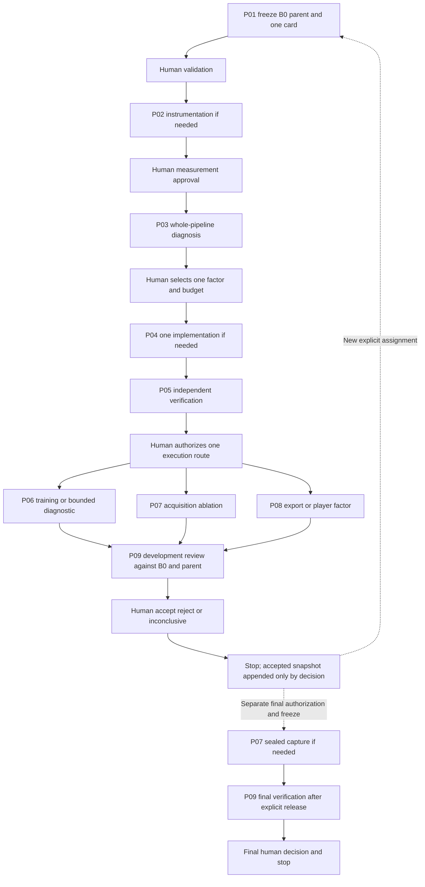

# Agent assignment guide

**Prepared prompts only. No agent is active or authorized by this document.** Assign one prompt after reviewing its exact phase, input allowlist, ownership and budget. Success of a previous prompt never authorizes the next. All prompts are standalone and incorporate the [complete-pipeline sequential protocol](06-sequential-optimization.md). Use the [experiment/result card](templates/experiment-card.md), filling every required field before execution.

## Reference and promotion rules

P01 is also the reusable literature/engineering selection gate for each stage: complete `templates/stage-review.md` using `07-use-case-literature-review.md`, then obtain human selection of one candidate. No additional agent role is needed. All later prompts consume that accepted review and report incompatible assumptions rather than silently substituting a method.

B0 is the immutable original pilot. A0 initially references the declared B0 mode. A(k-1) is the last human-accepted full configuration; Ck changes exactly one declared aspect of that parent. Every result reports Ck versus B0 and Ck versus A(k-1). Controls/replays have their own IDs and execution authorization. A positive agent report only recommends acceptance. The human accepts, rejects or declares the result inconclusive; rejection/inconclusive leaves the parent unchanged. Final quality success is distinct from accepting an intermediate development improvement.

Cover every stage in the ledger: acquisition, preparation, initialization, representation, training, evaluation, transfers, persistence/restart, rendering, export and visualization. A stage can be deferred with a reason. State-of-the-art backend replacement is permitted as a separately approved treatment, with its dependencies and total costs. It is not required and never silently bundled with other optimizations.

## Assignments and ownership

| Prompt | Role / phase | Prerequisite and human gate | Exclusive ownership |
| --- | --- | --- | --- |
| [P01](prompts/01.md) | Preparation: B0/A0, whole-pipeline ledger and one comparison card | Design review; resolve quality/input/scope/budget | New `decisions/<UTC>/` only |
| [P02](prompts/02.md) | Evaluation/telemetry implementation | Accepted metric, lineage and input contracts | New regional evaluator/contract module and dedicated tests |
| [P03](prompts/03.md) | Whole-pipeline diagnosis, approved frozen inference | Reviewed P02; exact allowed measurement modes | New diagnostic output only |
| [P04](prompts/04.md) | One factor implementation in one chosen stage | Diagnosis + named factor/backend package | Exact named implementation/test paths in the card |
| [P05](prompts/05.md) | Independent scope/integration verification | Candidate code ready; reviewer different from author | Review report and independent tests only |
| [P06](prompts/06.md) | One training run OR bounded preparation/transfer/persistence/evaluation diagnostic | Accepted review + exact execution mode/run ID | One experiment output, no source writes |
| [P07](prompts/07.md) | One acquisition ablation OR sealed final capture | Separate capture approval; tested adapter and scope budget | One new capture output, no source writes |
| [P08](prompts/08.md) | One export/player factor or frozen-path validation | Frozen model + exact codec/cache/display factor and budget | New export/player output; implementation only if explicitly assigned |
| [P09](prompts/09.md) | Independent development decision OR final verification | Development: exact candidate/references. Final: separate release and model/threshold freeze | New review output; no registry/model edits |

The same prompts can be assigned again for later factors, but every assignment requires its own card and approval. An unchanged ordinary control can skip P04 when P05 confirms the exact path; it cannot skip authorization. P06, P07 and P08 are alternative execution routes for the chosen factor, not mandatory consecutive experiments.

A capture-only review can accept technical dataset validity while reconstruction benefit remains pending. A later fitting assignment is needed to assess that benefit. A trained-model improvement likewise cannot claim playback success without relevant evidence. Every result marks these partial boundaries.

## Parallel work and conflict prevention

- Default execution is serial: one validated phase and one candidate factor at a time. No prompt authorizes agents, delegation or automatic scheduling.
- Read-only literature inspection or document preparation may be parallelized only by explicit assignment on disjoint owned outputs. No parallel candidate experiments or concurrent shared-device benchmarks: contention would undermine attribution.
- If a human separately authorizes a sealed-data custodian alongside unrelated preparation, record disjoint ownership and keep final content/quality impressions inaccessible to optimizers. The default sequence remains serial.
- Never give concurrent ownership of adapters, exporters, capture scripts, notebooks, contracts or shared tests. Reviewers report defects rather than changing the author's implementation.
- Existing `tools/export_4dgs.py`, `tests/test_4dgs_export.py`, root README and `docs/4dgs.md` had external changes at this revision. Refresh status/hashes and obtain explicit file ownership before a future edit. This dossier does not grant retroactive ownership.

## Mandatory assignment and evidence

Each card specifies human authorization, prompt/mode, stage, one before/after factor, fixed factors and coupled consequences; B0/accepted-parent/candidate IDs and hashes; scope/protocol/data/evaluator identities; allowed inputs; ownership; source/license references; authorized runs/replays; quality/non-regression/minimum-benefit criteria; CPU/GPU/wall/memory/disk/transfer limits and remaining campaign allowance; recovery; reviewer; final-data policy; stop and human decision points. Missing authorization or identities block dependent execution. I1 is an option pending approval, not permission to download weights. New full-duration scope is not comparable to the short B0 without a declared overlap and scope-matched control.

Every gate delivers before/after manifests, concurrent-drift status, exact checks and outcomes, phase timings with non-overlapping boundaries, resource measurements/missingness, all artifacts and actions not executed. Every experimental result includes absolute B0/parent/candidate columns and both deltas, comparability flags and uncertainty. A CPU test is not CUDA proof; a training image is not generalization; an archive-size reduction is not a memory/energy reduction.

The independent reviewer can reject faster training that increases total cost, damages quality, leaks inputs or cannot resume. Negative results remain evidence. P09 development reviews never consume the sealed final test. No intermediate result authorizes another implementation, run, capture or agent.
