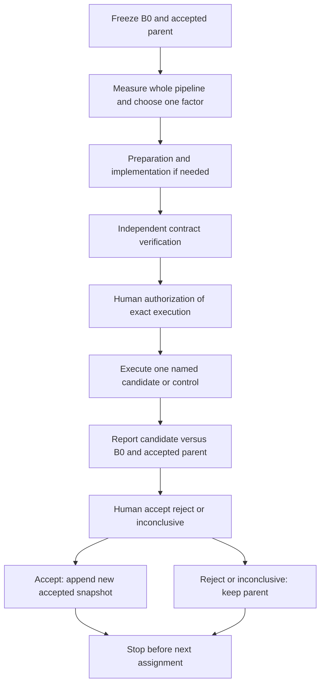

# Sequential optimization of the complete pipeline

Revision: 18 October 2026. **Documentation update only. No experiments, agents, installations, captures or training are authorized.** This protocol incorporates the user's latest clarification and governs experimental ordering, comparison and promotion wherever earlier design prose differs. Historical measurements remain unchanged.

## Objective and coverage

Evaluate every resource-relevant stage, one independently controllable aspect at a time: acquisition, preparation, initialization, representation, training, evaluation, checkpoint/restart, data transfers, rendering, export and visualization. Use state-of-the-art (SOTA) methods where evidence suggests a benefit; retain a simpler method if it provides the best demonstrated quality/cost trade-off. A1 static/dynamic separation is a leading candidate, not a fixed destination or a prerequisite for all other optimization. The HUST backend is a control, not a permanent constraint.

Every stage receives an entry in the stage ledger: measured bottleneck, missing measurement, candidate, tested/accepted/rejected/inconclusive/deferred, evidence and next decision. A stage may be deferred with a reason; it may not disappear from the scope simply because training improved. No promise is made that every proposed change will help, or that all stages can be tested within the first screening budget.

## Immutable original, accepted parent and candidate

| Identifier | Meaning | Mutation rule |
| --- | --- | --- |
| **B0** | Original historical pilot, with static/dynamic models, exact capture/split/initializer/backend/configuration and evaluator identities from the baseline audit; explicitly select the relevant mode for each comparison | Never overwrite, relabel as an improved model or substitute current working-tree code |
| **A0** | Initial accepted reference for the campaign, initially B0's declared mode for the matching scope; reference status does not imply it passes quality | No improved configuration is presumed accepted |
| **A(k-1)** | Last configuration explicitly accepted by the human, including its full dependency/data/export/player chain | Immutable parent snapshot |
| **Ck** | Candidate derived from A(k-1) with one declared treatment | Remains a candidate until review and human decision |
| **Ak** | Ck after explicit human acceptance | Append a new accepted snapshot; never overwrite its parent |

Each experiment reports **Ck versus B0** for cumulative progress and **Ck versus A(k-1)** for incremental impact. Rejection or an inconclusive result leaves A(k-1) unchanged. An agent's positive report does not promote Ck. Keep the original static model as an additional motion/background control where relevant.

The ordinary longer-training control remains mandatory before attributing a gain to a sophisticated method. It does not replace B0. For fairness, create separately authorized matched replays such as `B0-replay-<id>` and `A-replay-<id>` when hardware, timing allowance or environment differs. Preserve B0's historical measurements; a replay is new evidence with a relationship to B0, not a rewritten historical run. Reuse existing predictions/timings only when hashes, metric version and measurement conditions justify it.

## One treatment, explicit constants

Before choosing the treatment, complete a [stage review](templates/stage-review.md) using the [case-specific candidate matrix](07-use-case-literature-review.md). Compare credible literature alternatives and a simple/unchanged control; document which assumptions hold for the skier, static environment, occlusions and hardware. A candidate queue is not a predetermined implementation choice.

Before implementation, write the treatment as a concrete configuration/code difference: for example `foreground_loss_weight: 0 -> 0.5`, `decoded_cache_frames: 1 -> 4`, or `initializer: random -> calibrated_training_matches`. Declare fixed dataset, partitions, camera calibration, time interval, evaluation grid, random seeds, training budget, precision, model capacities, renderer, export codec and player settings except for the chosen factor.

Necessary consequences of the treatment must be listed: changing training resolution necessarily changes training intrinsics; changing camera count changes the selected observations under a fixed selection rule. These are not permission to independently tune other factors. A new backend may require an inseparable adapter/kernel/dependency package: label it a **package-level treatment** and claim only the package's effect. Do not claim that each internal change was isolated. Split separable changes into separate experiments.

Changing I0 to I1, adding original Blender masks, changing the temporal coverage, upgrading several dependencies or adding a new pose estimator is not neutral housekeeping. Record it as a treatment or a new scope with its own control. No hidden original geometry, depth, rig or test-time pose refinement enters an image-based comparison.

## Comparison and decision card

Every assignment uses an immutable card containing:

- Experiment ID, phase (preparation / implementation / diagnostic / training / acquisition / export / review), stage, hypothesis and exactly one factor with before/after values.
- B0 ID/hash, accepted-parent ID/hash, candidate ID, source/backend/submodule/weight hashes, data/split/protocol IDs and fixed scope (duration, views, evaluation resolution).
- Fixed factors, unavoidable coupled changes, dependency requirements, SOTA source/section/code reference and why the expected benefit applies here.
- Primary outcome and minimum useful improvement decided before execution; quality non-regression tolerances and uncertainty plan; quality gates are never relaxed after viewing a result.
- Explicit authorized runs, matching/replay plan, permitted hardware/environment, owned files, phase-specific time/memory/disk/transfer ceilings and remaining campaign budget. A comparison requiring extra controls is not implicit permission to run them.
- Recovery plan, stop rules, independent reviewer and human acceptance point.

The result card has three absolute columns (B0, A(k-1), Ck), two delta columns (Ck−B0, Ck−A(k-1)), measurement provenance, comparability flags and uncertainty/missingness. Report body, equipment, background, novel-view/new-time/joint quality, temporal stability, visual defects, preprocessing/training/evaluation/export/first-display time, peak host/device memory, disk/encoded/decoded size, transfers, recovery overhead and development effort. Cost deltas use `100*(candidate-reference)/reference`; negative means a reduction. Zero/unavailable denominators produce N/A with a reason. Never substitute absent measurements with zero.

Use both equal GPU-active training time and total end-to-end cost views. Timing differences between an old historical GPU run and a new machine are descriptive until matched controls support attribution. Cold cost includes initialization, setup/weights, transfers, retries, export and first display; warm cost names exactly what was reused. Compare the same delivered quality and temporal/spatial coverage. More cached frames or lower display resolution may be useful but must be named rather than hidden in a reported fps gain.

## Stage ledger and candidate queue

These are candidate factors, not automatic assignments. Sequence begins with whole-pipeline measurement and an ordinary training control, then selects one justified factor at a time. Acquisition has a separate approval boundary. Existing O0–O11 labels remain family names in the earlier matrix; the atomic IDs below prevent a family from becoming one bundled experiment.

| Stage / atomic IDs | Separate factors to consider, one per experiment | Main outcome and fixed comparison boundary |
| --- | --- | --- |
| D0 measurement | No optimization: read existing records and plan missing end-to-end measurements | Regional seen/novel quality, per-stage time/memory/bytes; profiler overhead recorded separately |
| T0 ordinary training | Duration only under a predeclared schedule policy; schedule shape separately if changed | Quality-versus-compute curve; initialization/capacity/masks fixed |
| T1 objective | Foreground weight; equipment weight; SSIM term as three separate candidates | Body/equipment fidelity and background non-regression |
| I1 initialization | Random versus image-correspondence initializer; then pair-selection policy separately | Convergence and total cost including matcher weights/preprocessing; synchronized moving-object views |
| R1 representation | Static/dynamic split; static freeze as separable toggles where possible | Quality, static interference, deformation/optimizer cost; joint depth ordering retained |
| T2 sampling | Camera/observation sampling policy; crop policy separately | Quality at equal training time; no validation/test residuals for sampling |
| R2 motion | Sparse controls OR articulated body OR one rigid-equipment part; clothing residual separately | Motion/occlusion correctness and total preprocessing/maintenance cost |
| R3 appearance | Shadow residual only | Shadow/background accuracy without geometric athlete leakage |
| T3 capacity | One deformation depth or grid resolution; density threshold; pruning rule separately | Thin-detail preservation versus memory/time; no simultaneous pruning and quantization |
| P1 preparation | Decode cache capacity; storage layout; worker count separately | Preprocessing/step stalls and complete process-tree memory; identical pixel tensors |
| X1 transport | Archive/compression policy; transfer batching separately | Cold transfer time/bytes and verification cost; identical input content |
| K1 persistence | Checkpoint cadence; serialization policy separately | Save overhead and bounded lost work; same recoverable state and no deletion of historical checkpoints |
| G1 rendering | Static-attribute cache; projection reuse; fused kernel/backend package separately | Render/gradient parity and real end-to-end speed; rail occlusion preserved |
| N1 precision | One tensor/operation precision change | Peak memory, speed and numerical/visual error; FP32 reference retained |
| E1 evaluation | Evaluation batching/cache only | Same metrics, support and records, with lower evaluation cost; metric-definition changes are protocol revisions |
| O1 export | Static-once packaging; temporal compression; SH reduction; attribute quantization separately | Encoded/decoded bytes, conversion/decoding cost and regional fidelity |
| V1 visualization | Frame-window size; preload/concurrency; display pixel ratio separately | Actual unique fps, latency, stalls and memory; output resolution explicitly controlled |
| A1 acquisition | Camera count; camera arrangement; temporal sampling; RGB resolution; render sample count separately | Final reconstruction quality at common evaluation views/times/resolution, including capture cost |

The atomic IDs in this table are stage identifiers; A1 acquisition here is not architecture A1. Assignment cards must use the full name (`acquisition/A1-camera-count`, `architecture/A1`, etc.) to avoid ambiguity. Strategies such as EDGS initialization, SC-GS controls or temporal compression are selected from the cited literature only when their dependencies and costs fit the stage. No new paper performance numbers are introduced by this revision.

## Scope changes, acquisition and full-duration work

The original B0 covers 0.9–1.9 s. The current repository README and `docs/4dgs.md` additionally record a requested full 0–5.02-s action. This is a coverage requirement, not a training authorization or a measured result. P01 must reconcile it explicitly: retain short-clip diagnostics, and design a separately budgeted full-duration comparison if that scope is selected. The 220-image holdout example and 20-minute run ceiling from the original dossier are not proof that full-duration capture/fitting will fit those limits.

When duration, reconstruction task or permitted information changes enough that B0 cannot predict the common evaluation set, start a named scope epoch. Preserve original B0 and report its comparison only on the valid overlap (or mark it unavailable); add a separately approved ordinary-backend **scope-matched reference** for the new task. Do not invent B0 predictions outside its interval or advertise a global speedup across unequal coverage. Keep reporting the last accepted parent within the new epoch and the historical baseline's limits.

Acquisition studies share a development evaluation set across camera/time/resolution variants, while the independent final test stays sealed. For example, change training camera count under a fixed selection rule and freeze other capture settings. Charge the real capture/preprocessing cost; subsetting existing data can estimate reconstruction sensitivity but is not a measured saving in rendering time. New camera placement/resolution/render sample settings require separately approved capture. New full-duration data must also have globally separated training/validation/final times.

I1 (calibrated images plus individually declared pretrained priors) is now the recommended **option for user approval**, allowing appropriate SOTA methods. I0 remains a prior-free control. Neither recommendation grants permission to install or download weights. Assisted masks/depth/rig remain separately named protocols. Differences in information available to a method must appear in the result card and cannot be attributed solely to better optimization.

## Acceptance, interactions and stopping

During development, an incremental candidate may be accepted as progress even if the final Q1–Q6 targets are not yet reached, provided it meets its preregistered benefit and non-regression criteria within budget. Record this as `ACCEPTED_FOR_DEVELOPMENT`, not final success. Final success still requires the agreed quality, playback, reproducibility and fair total-cost conditions. The original proposed 15% cost reduction is a possible final optimization criterion, not an automatic per-step threshold or an agreed user value.

An independent review uses **development** data after each step; only a separately authorized final review opens final data. Human acceptance appends Ak and updates the candidate queue. Rejection/inconclusive results preserve A(k-1), all negative evidence and used budget. No automatic fallback, promotion, next run or newly spawned agent follows.

One-factor-at-a-time results are conditional on their parent and order. They do not establish that effects add or identify a global optimum. If two accepted changes may interact, propose a separate bounded interaction test: parent with neither, each alone, both together, reusing valid existing runs. Execute only explicitly approved cells; each comparison edge changes one factor. Removing a factor from the accepted stack is also a separately approved test. Report interactions, do not multiply published speedups.

Stop a particular branch on adverse quality, exhausted benefit or infeasible dependencies; keep other stages in the ledger for explicit review. Satisfactory longer training does not automatically end acquisition, transfer, export or playback optimization. Budget exhaustion or missing comparable measurements stops execution and yields a decision request, never an expanded campaign.

## Sequential gate loop

Only documentation was updated now. All measurements, implementations and executions described here remain future separately authorized work.
