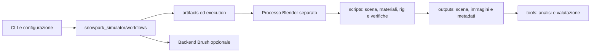

# Architettura

## Scopo

Il simulatore produce scene e immagini sintetiche ripetibili per esperimenti di acquisizione e ricostruzione 3D. Geometria procedurale, movimento cinematografico, render e valutazione sono responsabilità distinte. Un processo terminato correttamente non dimostra né accuratezza fisica né qualità della ricostruzione.

## Confini dei moduli

- **`cli.py`**: interfaccia a riga di comando (CLI), con elenco dei comandi e caricamento del solo workflow richiesto. Mostrare l'aiuto o importare il pacchetto non avvia subprocessi.
- **`workflows/`**: un modulo per attività. Sceglie input, fasi e file di scena; non costruisce mesh né contiene operatori Blender.
- **`artifacts.py`**: percorsi confinati nel repository, directory UTC, hash SHA-256 e copie dei sorgenti. Risolve anche i collegamenti simbolici prima dei controlli.
- **`execution.py`**: individua Blender, costruisce liste di argomenti senza shell e conserva log non sovrascrivibili. Tutti i workflow Blender usano la stessa modalità offline, senza autoexec.
- **`scripts/`**: codice che usa l'API di Blender e profili numerici riutilizzabili. I file `*_profile.py` e `reference_clock.py` sono matematica pura, verificabile senza Blender. `scene_support.py` raccoglie firme geometriche e impostazioni dei render.
- **`tools/`**: comandi separati per controllo dei dati, metriche, grafici e codifica video. Non sono dipendenze della demo statica.

## Famiglie di codice Blender

| Responsabilità | Moduli principali |
| --- | --- |
| Ambiente iniziale | `build_scene.py`, `verify_scene.py` |
| Morfologia e appoggi | `terrain_profile.py`, `terrain_geometry.py`, `refine_terrain.py`, `verify_terrain.py` |
| Personaggio | `athlete_proxy.py`, `athlete_fit.py`, `build_athlete.py`, `verify_athlete.py` |
| Abbigliamento e neve | `athlete_clothing.py`, `refine_appearance.py`, `compare_snow.py`, `presentation_scene.py` |
| Movimento | `motion_profile.py`, `trick_profile.py`, `rail_slide_profile.py`, `animate_scene.py`, `rail_slide_scene.py` |
| Sincronizzazione video | `reference_clock.py`, `retime_scene.py` |
| Acquisizione e varianti | `capture_scene.py`, `render_conditions.py`, `verify_condition_scenes.py` |

## Dati e riproducibilità

`configs/` contiene gli input modificabili. Ogni run ne conserva una copia locale con i sorgenti effettivi e i record di esecuzione. La copia del pacchetto host include anche i workflow: conservare soltanto il comando di ingresso non sarebbe sufficiente dopo l'estrazione delle routine comuni.

Le fasi successive richiedono una directory di run esplicita; non selezionano implicitamente l'ultimo `.blend`. Gli hash identificano gli input previsti, non certificano la fisica. Alcuni nomi dei file generati conservano le sigle storiche P1/P2 per mantenere compatibilità con i metadati e le scene precedenti.

La build statica, la riapertura indipendente, i test numerici e la navigazione manuale sono evidenze diverse. I test host sostituiscono Blender con un esecutore controllato solo dove verificano orchestrazione ed errori; non vengono presentati come render eseguiti.
