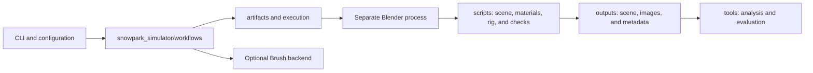

# Architecture

## Purpose

The simulator produces repeatable scenes and synthetic images for acquisition and 3D reconstruction experiments. Procedural geometry, cinematic motion, rendering, and evaluation have separate responsibilities. Successful process completion does not establish physical accuracy or reconstruction quality.

## Module boundaries

- **`cli.py`**: command-line interface (CLI), listing available operations and loading only the requested workflow. Displaying help or importing the package does not start subprocesses.
- **`workflows/`**: one module per activity. Selects inputs, stages, and scene files; does not construct meshes or contain Blender operators.
- **`artifacts.py`**: repository-scoped paths, UTC directories, SHA-256 hashes, and source snapshots. Resolves symbolic links before checking path containment.
- **`execution.py`**: discovers Blender, constructs argument lists without a shell, and preserves logs without overwriting them. Every Blender workflow uses the same offline mode with autoexec disabled.
- **`scripts/`**: Blender API code and reusable numerical profiles. The `*_profile.py` files and `reference_clock.py` contain pure mathematics and can be tested without Blender. `scene_support.py` collects geometry signatures and render settings.
- **`tools/`**: separate commands for data checks, metrics, plots, and video encoding. They are not dependencies of the static demo.
- **`pilot4d.py` and `notebooks/`**: a neutral camera/time partition contract and an optional, isolated Colab research runner. The notebook does not become a dependency of scene generation. See the [4DGS protocol](4dgs.md) for capture, backend adaptation and held-out evaluation boundaries.

## Blender code by responsibility

| Responsibility | Main modules |
| --- | --- |
| Initial environment | `build_scene.py`, `verify_scene.py` |
| Morphology and supports | `terrain_profile.py`, `terrain_geometry.py`, `refine_terrain.py`, `verify_terrain.py` |
| Character | `athlete_proxy.py`, `athlete_fit.py`, `build_athlete.py`, `verify_athlete.py` |
| Clothing and snow | `athlete_clothing.py`, `refine_appearance.py`, `compare_snow.py`, `presentation_scene.py` |
| Motion | `motion_profile.py`, `trick_profile.py`, `rail_slide_profile.py`, `animate_scene.py`, `rail_slide_scene.py` |
| Video synchronization | `reference_clock.py`, `retime_scene.py` |
| Capture and variants | `capture_scene.py`, `capture_motion.py`, `render_conditions.py`, `verify_condition_scenes.py` |

## Data and reproducibility

`configs/` contains editable inputs. Each run preserves a local copy together with the actual sources and execution records. The host package snapshot includes the workflows: preserving only an entry command would be insufficient after extracting shared routines.

Subsequent stages require an explicit run directory; they do not implicitly select the latest `.blend`. Hashes identify the expected inputs, not physical validity. Some generated filenames retain the historical P1/P2 labels for compatibility with previous metadata and scenes.

Static builds, independent reopening, numerical tests, and manual navigation provide different evidence. Host tests replace Blender with a controlled executor only when testing orchestration and error handling; they are not presented as completed renders.
